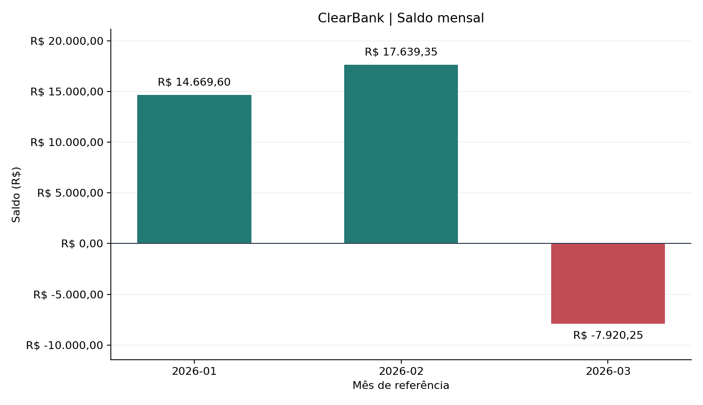

# ClearBank — Análise Financeira com Python

Projeto acadêmico que lê um CSV de transações bancárias fictícias, valida e limpa os registros, calcula métricas mensais, sinaliza valores acima de R$ 10.000,00 e exporta um relatório JSON.

A solução principal usa a biblioteca padrão do Python: `csv.DictReader`, `datetime`, `json`, funções e tratamento de erros. Os opcionais usam pandas para uma análise alternativa e matplotlib para o gráfico.

## Arquivos

| Arquivo | Finalidade |
| --- | --- |
| `desafio-final.ipynb` | Notebook principal, com testes e saídas salvas |
| `transacoes.csv` | Entrada preparada separadamente, com dados fictícios válidos e inválidos |
| `relatorio.json` | Resultado gerado pela execução da solução nativa |
| `analise_pandas.py` | Versão alternativa com leitura e agrupamento em pandas |
| `grafico.png` | Gráfico do saldo mensal, gerado com matplotlib |
| `requirements.txt` | Dependências dos dois opcionais |

## Como executar no Google Colab

1. Abra o Colab e importe `desafio-final.ipynb` pelo menu **Arquivo → Fazer upload de notebook**.
2. No painel **Arquivos**, envie `transacoes.csv` e `analise_pandas.py` para a pasta da sessão.
3. Execute todas as células em ordem, pelo menu **Ambiente de execução → Executar tudo**.
4. Confira os testes, o relatório e a comparação com pandas. `relatorio.json` e `grafico.png` aparecerão na pasta da sessão.
5. Salve ou baixe o notebook **depois da execução**, preservando as saídas. Baixe também os arquivos gerados, caso queira atualizar os resultados no repositório.

O CSV deve existir antes da execução. O notebook não cria nem sobrescreve o arquivo de entrada. Ao reiniciar a sessão do Colab, envie os arquivos novamente.

## Como executar localmente

Requer Python 3.10 ou superior. Na pasta do projeto:

```bash
python -m pip install jupyter -r requirements.txt
jupyter notebook desafio-final.ipynb
```

Execute todas as células em ordem. A análise principal usa apenas módulos nativos. As células opcionais exibem uma orientação se suas dependências ou o arquivo auxiliar estiverem ausentes.

Para executar apenas a versão alternativa:

```bash
python analise_pandas.py
```

Esse comando imprime o resultado da análise com pandas; a geração de `relatorio.json` e `grafico.png` fica no notebook.

## Regras e métricas

- Cabeçalho esperado: `id,data,cliente_id,tipo,valor,descricao,categoria`.
- ID inteiro, cliente preenchido, data existente no formato exato `AAAA-MM-DD`, tipo `credito` ou `debito`, valor numérico finito e maior que zero.
- Espaços nas extremidades são removidos. Linhas inválidas são descartadas silenciosamente; o resumo mostra as contagens.
- A primeira ocorrência **válida** de cada ID é mantida. Duplicatas posteriores contam como inválidas; sua quantidade também é informada separadamente.
- Por mês: quantidade, créditos, débitos, saldo, média e registros completos de maior e menor valor. Empates preservam a primeira ocorrência.
- A conversão para `float` é verificada em `try/except`. Os cálculos monetários usam `Decimal`, com arredondamento para centavos por `ROUND_HALF_UP` na exportação.
- `valor > LIMITE_SUSPEITO`, com `LIMITE_SUSPEITO = 10000.00`. Exatamente R$ 10.000,00 não é sinalizado.
- O período usa a base limpa. Os dias decorridos usam a data de execução em `America/Recife`; a amplitude mede a diferença entre a data mais antiga e a mais recente.
- Um arquivo apenas com cabeçalho gera um relatório vazio. Arquivo ausente exibe uma orientação e interrompe a análise sem escrever um JSON novo.

A sinalização por valor é uma regra didática, não uma conclusão sobre fraude. Todos os dados são fictícios.

## Resultado esperado da amostra

São **30 registros lidos**, **18 válidos** e **12 inválidos**, incluindo **1 duplicata**. O período vai de **2026-01-05 a 2026-03-30**, com amplitude de **84 dias**.

| Mês | Quantidade | Créditos | Débitos | Saldo | Média |
| --- | ---: | ---: | ---: | ---: | ---: |
| 2026-01 | 6 | R$ 15.700,00 | R$ 1.030,40 | R$ 14.669,60 | R$ 2.788,40 |
| 2026-02 | 6 | R$ 19.300,00 | R$ 1.660,65 | R$ 17.639,35 | R$ 3.493,44 |
| 2026-03 | 6 | R$ 5.300,00 | R$ 13.220,25 | -R$ 7.920,25 | R$ 3.086,71 |

As duas transações sinalizadas são o **ID 7**, de R$ 15.000,00, e o **ID 13**, de R$ 12.500,00.



## Verificações incluídas

O notebook contém testes para campos inválidos, datas e ano bissexto, valores não finitos, ID duplicado, fronteira do limite, métricas conhecidas, arquivo inexistente, base vazia, serialização JSON e falha ao salvar. Também compara contagens, métricas mensais, registros extremos e transações sinalizadas com a implementação independente em pandas.

Os resultados esperados nos testes correspondem ao CSV fornecido. Se trocar a amostra, atualize essas expectativas. A data de geração e os dias decorridos mudam conforme a execução.
